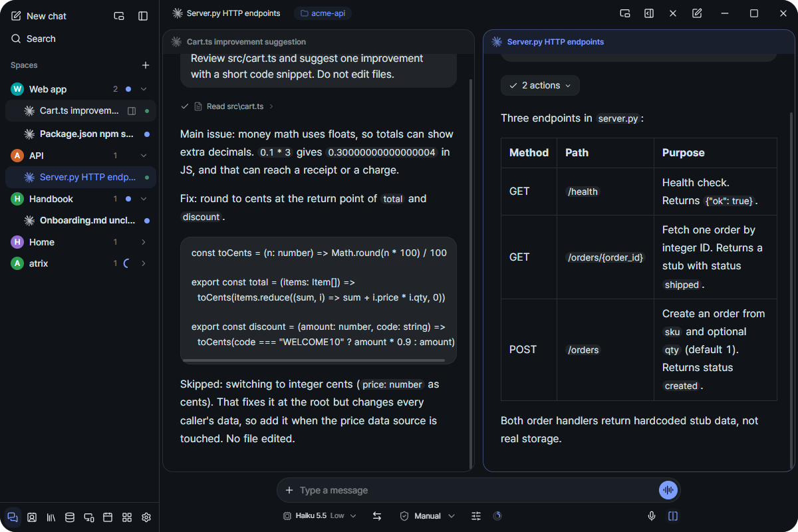
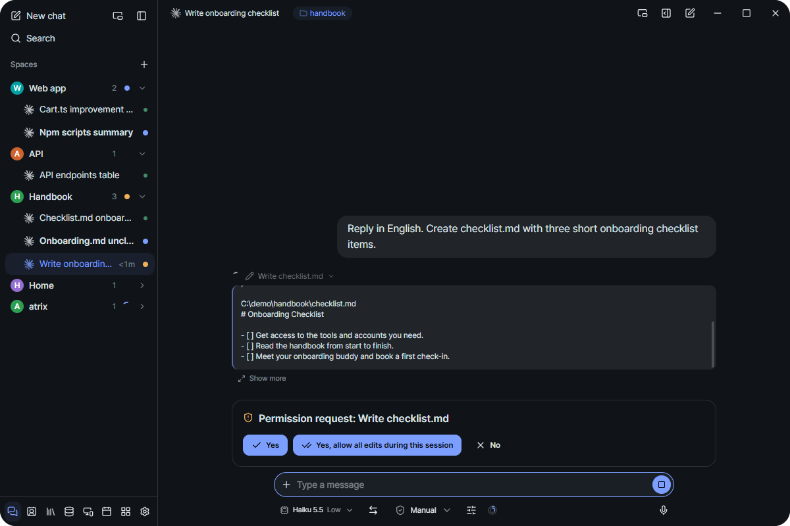
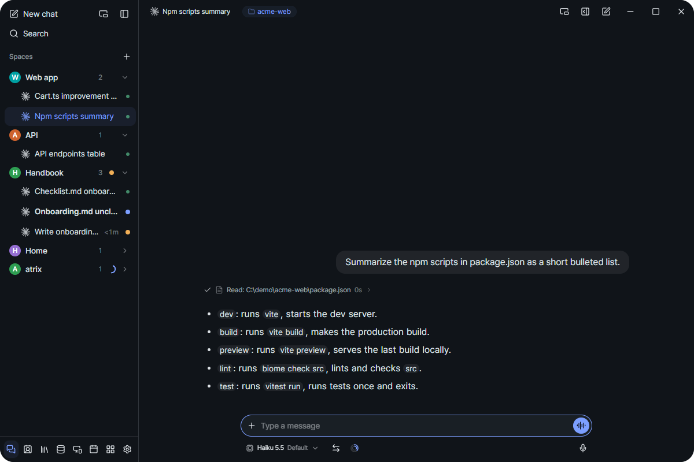
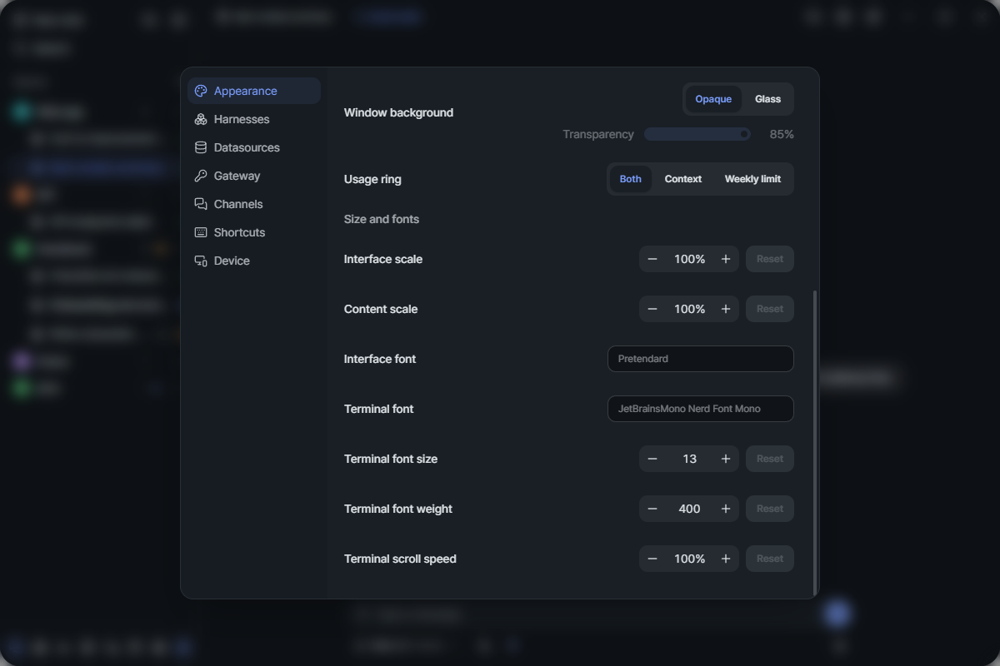
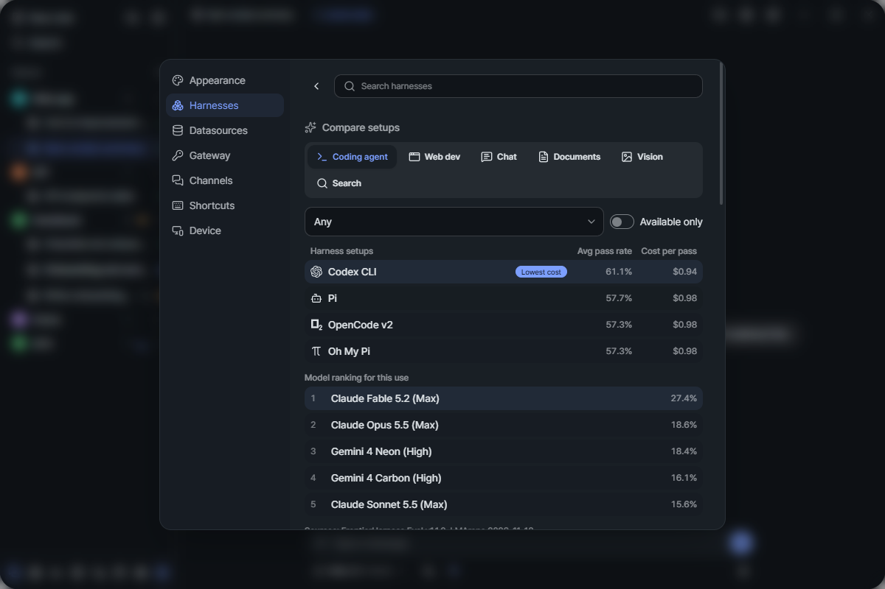

<h1 align="center">Atrix</h1>

Run Claude Code, Codex and other coding agents side by side, and drive them from any paired device.

  <a href="https://github.com/pleahmacaka/atrix/releases/latest"><kbd> Download for Windows </kbd></a>

<table>
  <tr>
    <td></td>
    <td></td>
  </tr>
  <tr>
    <td></td>
    <td></td>
  </tr>
</table>
